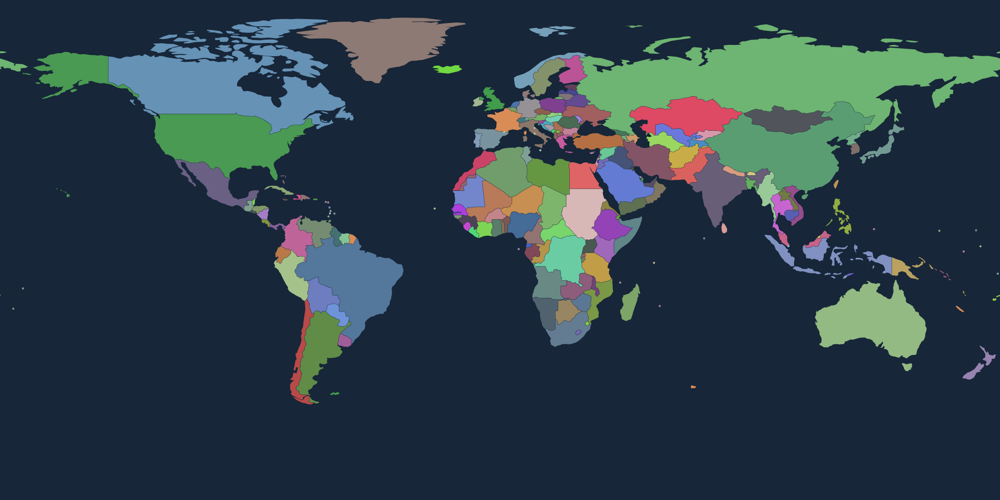

# Мир 2010 · Age of Clicks

Начало разработки мода с картой мира на **1 января 2010 года**.

**Продолжение с ПК — World Events & Ideologies:** сохранены [исходный каталог из 179 событий](data/event_catalog/age_of_clicks_events_2010_2026.csv) и [все требования с памяткой для продолжения](docs/WORLD_EVENTS_2010_2026_HANDOFF.md). Реализация поставлена на паузу по просьбе пользователя; сначала нужны проверка установленного редактора и пять успешно испытанных в игре событий. Каталог пока не подключён к игровому импорту.

**Статус: исходники сценария и карта для подготовки в редакторе. Нативный импорт в Age of Clicks пока не реализован и не проверен.** Файлы JSON этого проекта — собственный промежуточный формат, а не формат игры. Готового устанавливаемого мода пока нет.



Добавлен [слой городов мира с данными за 2010 год](docs/CITIES.md): **9 793 городских центра GHSL** в CSV, GeoJSON и на [карте с городами](dist/world_2010_cities.svg). Это агломерации, а не полный реестр всех муниципальных городов и посёлков. Малые города ещё предстоит добавить из других исторических источников.

Добавлена [дипломатия на дату старта](docs/DIPLOMACY.md): **82 соглашения и объединения**, таблица всех **19 503 пар стран**, 23 исторические поправки и справочник 98 формальных договоров COW. Составы и правовые типы отделены от игровых числовых оценок. Полнота реестра всех торговых договоров и индивидуальная проверка всех двусторонних отношений не заявляются.

## Что уже сделано

- Географическая основа мира Natural Earth 1:110m; интерактивные подсказки при открытии SVG отдельно в браузере.
- Крым в составе Украины; Южный Судан в составе Судана; Сомалиленд объединён с Сомали для выбранного игрового представления.
- Гренландия, Пуэрто-Рико и ряд других зависимых территорий отнесены к государствам, указанным в настройках.
- Названия «Свазиленд» и «Македония», составы НАТО (28), ЕС (27) и ОДКБ (7) на начало 2010 года.
- Военные договоры, консультационные механизмы и торговые режимы разделены. Учтены поэтапные вступления, «перезагрузка» 2009 года и ключевые конфликтные отношения; числовая модель использует голосования ООН за 2009 год и явные игровые поправки.
- Цветовая таблица стран, GeoJSON, SVG, контрольные суммы и воспроизводимая сборка.
- Все 9 793 записи GHSL с населением за 2010 год: точки внутри городской геометрии 2010 года, привязка к странам сценария и отчёт о покрытии. Проверенные исторические названия хранятся отдельными правками; остальные названия требуют исторического аудита.
- Три заготовки событий 2010 года: Гаити, греческий долговой кризис, протесты в Тунисе. Это описание дизайна, не работающие игровые события.

Карта содержит **169 объектов с полигонами и 29 малых государств с точками**. Точки не дают территории и не готовы для игрового захвата. Набор 1:110m не содержит всех островов и деталей границ; текущий результат не является полной исторической реконструкцией. Отдельное отображение Косово, Тайваня, Палестины, Северного Кипра и Западной Сахары — игровое представление, требующее дальнейшей настройки. Подробнее: [ограничения карты](docs/MAP_POLICY.md).

## Сборка

Нужен Python 3.10 или новее. Внешних библиотек нет; исходная география уже в репозитории.

```sh
python tools/build.py
python -m unittest discover -s tests -v
```

Откройте `dist/world_2010.svg` в браузере. `dist/countries.csv` — таблица стран, цветов и блоков; `dist/world_2010.geojson` — география. Результаты сборки хранятся в Git, а CI проверяет их соответствие исходникам.

Для городов: `dist/world_2010_cities.svg`, `dist/cities_2010.csv`, `dist/cities_2010.geojson` и `dist/cities_2010.report.json`. Обычная сборка работает без сети и сторонних пакетов. Зависимости в `tools/requirements-import.txt` нужны только для повторного импорта первоисточника GHSL.

Для дипломатии: [таблица объединений](dist/diplomacy_2010.summary.md), `dist/diplomacy_2010.json`, `dist/relations_2010.csv` и `dist/diplomacy_2010.report.json`. Пустые оценки и непроверенные статусы не считаются нейтралитетом или отсутствием дипломатических отношений. Все числовые оценки — игровые, не объективная историческая шкала.

## Следующий этап: перенос в игру

Нужен экспорт пустого мода с одним сценарием из установленной версии Age of Clicks. Он позволит подтвердить структуру `mod.txt`, файлов карты, идентификаторов стран и дат. После этого можно написать адаптер к реальному формату и проверить загрузку в игре. Инструкция: [интеграция с редактором](docs/INTEGRATION.md).

В репозитории намеренно нет выдуманного `mod.txt` и архива с обещанием установки. Игра и её платные ресурсы сюда не включены.

## План

- [x] Зафиксировать дату и географическую основу.
- [x] Сделать первые исторические правки, палитру и проверку сборки.
- [ ] Проверить полный список стран, спорные территории и мелкие острова.
- [ ] Получить образец экспорта редактора, реализовать нативный адаптер.
- [x] Добавить полный доступный слой городских центров GHSL за 2010 год.
- [ ] Расширить охват малых городов, проверить исторические названия и столицы.
- [ ] Добавить флаги и игровой баланс населения/экономики на 2010 год.
- [x] Подготовить историческую основу отношений, военных и торговых соглашений на 1 января 2010 года.
- [ ] Продолжить проверку двусторонних отношений и торговых договоров; перенести модель в нативную дипломатию игры после подтверждения формата.
- [ ] Реализовать и проверить события, собрать первый игровой архив.

Исходники проекта — MIT; география Natural Earth — public domain; данные городов GHSL и производные от них — **CC BY 4.0**, European Union / JRC. [Источники и происхождение](docs/SOURCES.md).
